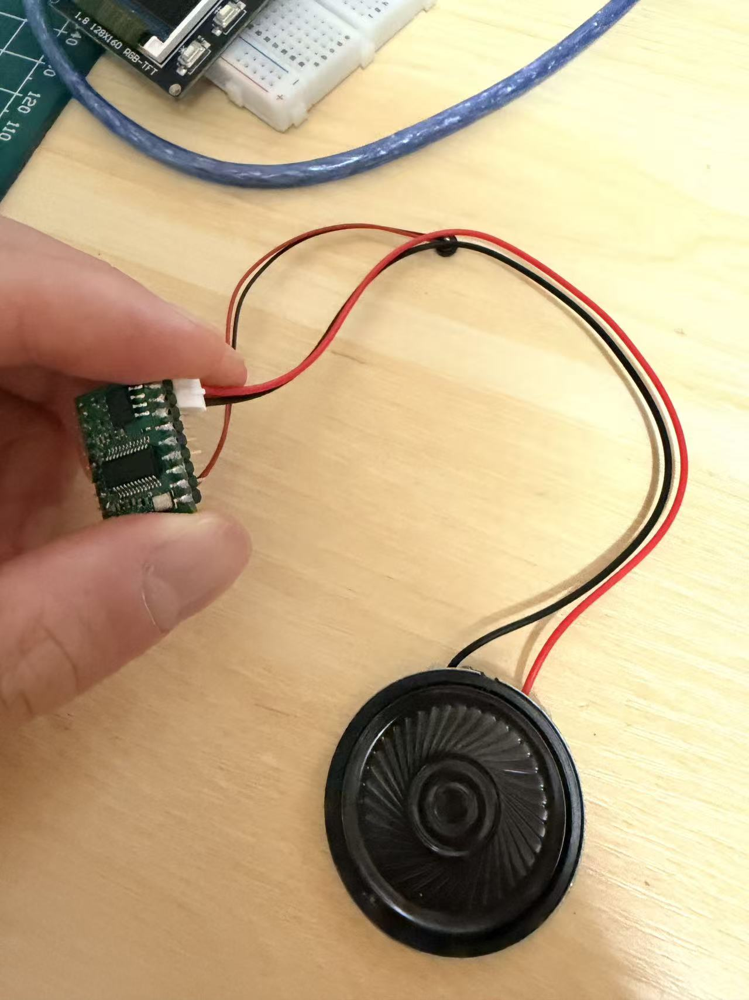

# 语音模块与喇叭接线

## 结论

当前选的是 **LU-03T / SU-03T 离线语音模块**，不是 `MAX98357A + I²S` 方案。

- 喇叭直接接语音模块的 **SPK+ / SPK-**。
- 喇叭不要接 ESP32-S3 的 GPIO、3.3V 或 5V。
- 语音模块负责识别、语音合成和功放，ESP32-S3 只需要通过 UART 发控制命令。

实物照片：`喇叭与语音模块接线.jpg`。

## 一、喇叭接线

按 LU-03T 规格书，模块上的喇叭输出是：

| 模块引脚 | 名称 | 接喇叭 |
|---|---|---|
| 17 | SPK- | 喇叭黑线 / 负极 |
| 18 | SPK+ | 喇叭红线 / 正极 |

如果模块上已经有白色 2Pin 座，直接把喇叭的 2Pin 插头插上即可，不需要再接 ESP32。

注意：

1. **SPK+/SPK- 是差分输出，不能把任意一端接地。** 不要把喇叭的一根线接到 GND，也不要把喇叭接到 3.3V/5V。
2. 支持 **4Ω 或 8Ω** 喇叭；照片里的 4Ω/8Ω 小喇叭可以直接使用。
3. 红线优先接 SPK+，黑线优先接 SPK-。接反通常不会烧模块，但相位相反；能响就不是接线错误。
4. 喇叭线尽量短，远离麦克风和 I²C/SPI 信号线。

## 二、语音模块供电

| 模块引脚 | 接到 | 说明 |
|---|---|---|
| VCC（1 脚） | **5V** | 模块要求 5V 输入，电流能力至少 550mA；建议用 5V/1A 电源 |
| GND（2/16 脚） | **GND** | 必须与 ESP32-S3 共地 |
| 3V3（3 脚） | 不接 | 这是模块内部 3.3V 输出，不要当 5V 输入使用 |

不要用 ESP32 的 3.3V 给语音模块供电。音频峰值电流较大，建议使用扩展底板的 `5V_OUT`，或者单独的 5V/1A 电源；如果使用 USB 供电，注意 USB 口和线材的电流余量。

## 三、与 ESP32-S3 的 UART（已接入提示音）

ESP32 固件已经使用以下 UART 向语音模块发送提示音消息。UI 线程只负责入队，独立任务负责发送，不会阻塞 LVGL 动画。

| ESP32-S3 | 接到语音模块 | 说明 |
|---|---|---|
| GPIO15 / UART1 TX | B6 / UART1_RXD（6 脚） | ESP32 发命令给语音模块 |
| GPIO16 / UART1 RX | B7 / UART1_TXD（5 脚） | 语音模块回传状态给 ESP32 |
| GND | GND | 必须共地 |

说明：

- LU-03T 的 B6/B7 是 3.3V UART，可直接接 ESP32-S3，不需要电平转换。
- 模块的 **B0/B1（14/15 脚）是调试/烧录串口**，不要拿来接 ESP32 的业务 UART；ESP32 通信优先用 B6/B7。
- 不要把语音 UART 接到 GPIO17/18：当前工程中 **GPIO18 已被 BME690 的 I²C SCL 占用**，GPIO17/18 不能同时作为 UART1 使用。
- 串口固定为 **9600 8N1，无流控**，帧格式为 `AA 55 消息号 55 AA`。消息号 1 到 9 的触发时机和模块配置步骤见 `..\SU-03T语音模块\提示音串口协议.md`。

## 四、先单独验证喇叭

1. 只接语音模块的 5V、GND 和喇叭，先不接 ESP32 UART。
2. 上电，确认模块没有明显发热，5V 电压没有大幅跌落。
3. 如果出厂固件有开机提示音或唤醒词，应该能从喇叭听到声音。
4. 没有声音时依次检查：
   - 5V 电源是否足够；
   - SPK+ / SPK- 是否接反或接触不良；
   - 喇叭是否为 4Ω/8Ω；
   - 模块是否已经烧录了带语音输出的固件；
   - 音量配置是否被设为 0。

## 五、资料

- `..\SU-03T语音模块\【1】Su-03t原理图.pdf`：实际内容为 **LU-03T 规格书**，其中管脚表给出 SPK+/SPK-（17/18）和 B6/B7 UART。
- `..\SU-03T语音模块\资料清单.md`：官方资料包索引。
- `喇叭与语音模块接线.jpg`：实物照片，喇叭已经接在模块的 2Pin 座上。
- `..\SU-03T语音模块\提示音串口协议.md`：提示音消息号、帧格式和模块端烧录配置。
